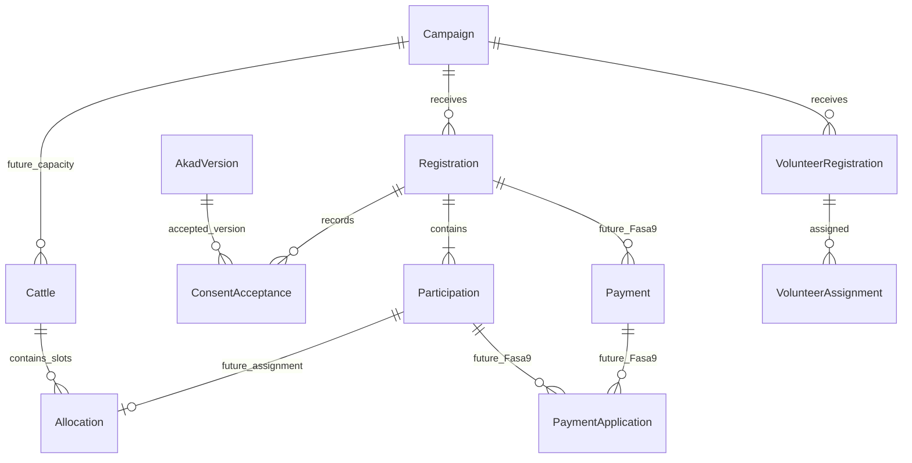

# Qurban MVP — Fasa 8.0 complete / owner-approved

13 October 2026 (+08:00), final owner decision lock. **Fasa 8.0 complete / owner-approved.**
Canonical baseline `abdcd9b929b2d705a9add07fc799f94a8eb6d10b`,
tag `phase-7-campaign-engine-complete`. Fasa 7 is complete / owner-approved.
**Architecture and local UX prototype checkpoint.** Owner manually tested the Qurban/Aqiqah registration + payment-proof dummy flow and volunteer flow, approving the current MVP UX direction. The decisions below are explicitly locked; no production schema/runtime domain implementation is included.

Checkpoint: `phase-8.0-qurban-architecture-prototype` (resolve tag for commit). Overall Fasa 8 is in progress; **8.1 is next / not started**, Fasa 9 is not started. Stop after committing/tagging/pushing 8.0. The reviewed prototype remains non-persistent and is not production registration.

## Evidence and provenance

Both original files **were reopened directly in this Work session** from Downloads:

- `C:\Users\User\Downloads\Peserta Qurban MTU 2026.xlsx`: read-only workbook inspection.
- `C:\Users\User\Downloads\21. Borang Qurban MTU 2026.pdf`: full text extraction and rendered page inspection.

These source files were inspected in the initial 8.0 work and were not reopened again for this owner-feedback refinement. The bank reference and revised workflow decisions below were supplied directly by the owner on 13 October 2026.

No participant names, phone numbers, addresses or payment records are copied into source, screenshots, fixtures or this plan. The owner-provided verified facts supplement the inspection. The prototype uses invented data only.

### Paper form

The heading is 2026/1447H. One form contains applicant/contact name, address and telephone, followed by several participant-name lines. It offers Qurban/Aqiqah, cattle shares priced at RM880 in 2026, with 1–7 shares costing RM880–RM6,160. There are eight participant-name lines, so the pricing ladder does **not** establish a maximum of seven participants per registration. Any future per-submission limit needs a reviewed registration rule.

Payment choices include Tunai, Deposit Tunai and Cek, with payment instructions. They are historical source evidence only. The owner has now chosen Bank Islam transfer only for the new workflow; these older alternatives do not become new payment controls. The form includes a wakalah for purchase, slaughter and meat distribution, with any excess balance used for administration costs, followed by signature/date. Attendance is “Saya AKAN/TIDAK AKAN hadir”. That wording does not prove attendance applies to each participant independently.

### Operational workbook

Main tracker `Sheet2` has headers on row 3, numbered participant rows 4–108:
`Bil`, `Nama Peserta`, `No Peserta`, `No Lembu`, `No telefon`, `Tarikh Bayaran`, `Catatan (tunai/transfer)`.
There are 105 numbered rows. Each No Peserta 1–7 occurs 15 times. No Lembu uses merged cells spanning each seven-row group (15 cattle), rather than 105 individually populated cattle cells.

Payment-note counts across those rows: TRANSFER 44, TUNAI 5, CDM 2, CEK 1, BANK IN 1, blank 52. Blank notes do not prove unpaid status. Two cells contain AQIQAH; receipt notes also occur. No paid/receipt reconciliation or financial total is inferred from these notes. Other sheets `Sheet3` and `canva (Jgn Usik)` exist but do not replace the main operational tracker as the modelling source.

The workbook title in A1 says “Peserta Qurban MTU 2025”; actual date-valued payment cells belong to 2026. Campaign year, approved Hijri/display label and configuration must be authoritative. Never infer the year from filenames, sheet names or titles.

## Reconstructed 2026 workflow

1. An applicant submits contact details and one or several intended participants, with Qurban/Aqiqah purpose, wakalah, signature/date and attendance choice.
2. Urus setia records participants against cattle groups and share slots, then manually tracks contact/payment dates/methods and receipt follow-up.
3. Cattle 1–15 each has slots 1–7. The repeated No Peserta is a **local share-slot number**, not a unique participant/person ID.
4. Payments and receipts are coordinated manually; the records do not prove reservation timing, instalment rules, allocation eligibility or refund policy.

The source establishes observable records, not the exact chronological order of payment confirmation versus allocation. Those operational rules need owner confirmation.

## Why a spreadsheet row cannot be the domain model

One row combining name, contact, payment, receipt and cattle creates repeated contact data, makes mixed purposes into notes, confuses payment with eligibility and treats a local slot as identity. It cannot reliably express a payer covering a family, multiple payments, cancellations, reassignment or a volunteer with no Qurban share. Names and telephone numbers are neither unique nor evidence of linkage.

Do not create a deduplicated global Person registry in this MVP by matching names. A Participation is an independent ibadah/share record, not proof of a unique real-world person. Repeat names may legitimately refer to different people or separately reviewed shares.

## Proposed concepts and relationships (not migration DDL)



| Concept | Proposed responsibility / fields |
| --- | --- |
| Campaign | Generic engine ID, lifecycle, windows, visibility and flags. Qurban reviewed type/config extension contains non-PII year/pricing/rules only. |
| Registration | Opaque internal ID, non-guessable public reference, campaign_id, applicant_name, phone, address, optional email; applicant/wakil attendance (`yes/no/unsure`), same-cattle request preference and minimal status `submitted/cancelled`. |
| Participation | Own opaque ID, registration_id, participant_name, purpose=`qurban` or `aqiqah`. Exactly one cattle share per Participation in this workflow. |
| AkadVersion | Immutable approved text/reference, version, approval provenance and content fingerprint. Approval governance separate from acceptance. |
| ConsentAcceptance | registration_id, approved akad version/reference, accepted_at (future server timestamp), immutable accepted text/version fingerprint and the reviewed participation snapshot/revision. |
| Cattle (future) | ID, campaign_id, display_number, capacity. Display number is scoped to campaign. |
| Allocation (future) | cattle_id, slot_number, participation_id. Current allocation distinct from its reassignment history. |
| VolunteerRegistration | Independent ID/campaign, name, phone, optional email, shirt_size, also_participant (informational answer), optional participant_name_information when Yes. This owner-supplied name is not an FK, verified identity or link. |
| VolunteerAssignment | volunteer_registration_id, team/task, optional cattle/group, controlled status. No requirement for a payment or Participation. |
| Payment / PaymentApplication / Receipt | Fasa 9 designs verified funds, payer, amount, application to registrations/participations and receipts. No persistence is implemented in 8.0; payment/proof status wording is simulated UI only. |

### Applicant, participant and payer

The applicant is the contact submitting one Registration. They need not be a participant. A payer is a future payment-side identity/contact and may differ from both. No public Supabase/Admin account is required. Public references must be cryptographically non-guessable and must not serve as sole authority to retrieve PII; future private retrieval needs a separately reviewed capability/verification flow. Spreadsheet Bil and No Peserta never become public identity.

Example: applicant Safwan registers Ahmad—Qurban, Aminah—Qurban and Yusuf—Aqiqah. That is one Registration and three Participations, three shares at the campaign's accepted price. Phone/address live once on Registration. Purpose is typed domain data, never an AQIQAH note. Names are examples, not imported records.

## Year-specific configuration and price integrity

**Owner-locked schema/configuration approach:** Fasa 8.1 must support reviewed, strictly validated `campaign_year`, `hijri_year`/display label, `currency`, `price_per_cattle_share`, `cattle_count`, `shares_per_cattle`, `allowed_purposes`, registration rules and `approved_akad_version`, plus optional `volunteer_whatsapp_group_url`. The group URL is reviewed public-safe campaign information, never volunteer PII; displaying it requires no consent checkbox. No production descriptor/config is created now. RM880 is historical fixture data only. Money must use exact integer minor currency units, never floating point. `price_per_cattle_share` represents the reviewed minor-unit price in the configured currency; reusable calculations take that approved price as input. The config structure is approved; actual annual year/Hijri/price/capacity values remain campaign-launch configuration. No next-campaign price has been decided, no 2027 price may be invented, and no future price is seeded here.

Once a submission is accepted, record its immutable config/price version or quoted-price snapshot in the domain, so changing next year's price or correcting configuration cannot silently rewrite earlier obligations. Owner decision (8.3): ordinary authorized participant-name/purpose corrections need no new akad acceptance; original quote and consent remain immutable. Public safe display projections may include approved year, price and capacity, but not raw domain configuration, private records or accepted consent snapshots.

Prototype fixture: 2026, RM880/bahagian, 15 cattle, 7 shares/cattle, capacity 105. Every screen retains: **“Contoh berdasarkan Qurban MTU 2026 — bukan harga 2027 yang diluluskan.”** Nothing is seeded in any database.

## Attendance and group preference

**Owner-locked:** attendance belongs to Registration / applicant-wakil, not Participation. Approved values: `yes`, `no`, `unsure`; Malay labels: Ya, Tidak, Belum pasti. The prototype asks “Adakah pemohon/wakil bercadang hadir pada hari program?” Scope and third option are resolved. No per-participant attendance without a future reviewed requirement.

“Jika boleh, letakkan peserta dalam pendaftaran ini pada lembu yang sama” is a Registration preference, never a guaranteed slot. More than seven requested shares cannot fit one reference cattle; show an explanation later rather than imply a guarantee. Do not infer family/group from surnames, applicant, payment or similar names.

## Akad / consent

**Owner-locked MVP mechanism:** checkbox acceptance in the public registration UX. No typed signature, drawn signature or electronic-signature feature is required for MVP. This is an architecture decision, not legal advice.

Persistence records the exact approved akad version/reference, accepted timestamp, and immutable content fingerprint/snapshot sufficient to establish which version was accepted. A boolean alone is insufficient. Every wording edit creates a new version; historical acceptance must never be rewritten. The reviewed participation snapshot/revision associates acceptance with submitted names/purposes. Owner decision (8.3), superseding the earlier reacceptance candidate: ordinary authorized participant name/purpose correction does not require a new akad acceptance. Historical acceptance remains immutable evidence of the original submission. Current participants may intentionally differ; bounded operational audit records the correction. No pending_reacceptance state or public reacceptance flow. Add/remove participants and requote remain deferred.

The prototype preserves the full 2026 source paragraph, including surplus-use meaning, under `mtu-paper-2026-1447h-source-review-v1`. Actual annual production wording and approval provenance remain a final administrative **campaign-launch gate before registration opens**. Approval of the MVP mechanism does not approve future annual wording or grant new proxy authority.

The demo requires consent before review and dummy submit. Accepted version/time exist only in current in-memory UI state after participant submission; reload loses them. No real signature/consent evidence is collected.

## Capacity, reservation and allocation

**OWNER-LOCKED: Capacity Policy B — verified payment reserves capacity.** A/C were considered during 8.0 and are not selected. There is no unresolved A/B/C decision.

- Registration submission is a request, **not a reserved share**; it consumes no capacity.
- Payment-proof submission is unverified evidence, **not a reserved share**; it consumes no capacity and never establishes verified payment.
- Authorised admin payment verification **plus an atomic capacity eligibility check** may establish reserved/eligible shares. Verification must check and claim eligible capacity atomically before confirming participation eligibility.
- If capacity is full, never silently confirm another Participation. Surface the exception for the approved overflow/refund/waitlist procedure; do not invent an automatic outcome now.

Requested shares count submitted active Participations. Reserved/eligible shares come only from the authoritative Policy B admission result, never registrations or uploaded slips. Remaining capacity uses that counter, never `105 - registration count`.

Bank transfer/manual verification makes payment-after-capacity-exhaustion risk material. Exact pre-payment guidance, overflow/refund/waitlist procedure and payment exceptions must be finalised before the relevant production/payment phase. Those details remain open; **Policy B itself is locked**.

**8.4 / Fasa 9 dependency:** Fasa 8 can build capacity/allocation structure and protected operations. Final payment-qualified eligibility integration requires Fasa 9 verified payment. Fasa 8 alone must not claim to verify funds or confirm payment-qualified eligibility.

Future allocation invariants: same campaign for cattle and Participation; unique current (cattle_id, slot_number); one current allocation per Participation; slot within capacity; atomic admission/reassignment/cancellation and eligible-total bounds; stable audit history. Cancelled/ineligible records cannot quietly retain consuming allocations. Deterministic locking/idempotency prevents concurrent final-share claims. Detailed allocation/reassignment/cancellation rules remain for the relevant phase. No allocation persistence is introduced here; dummy submissions assign no cattle/slot.

## Payment boundary — owner-resolved channel, Fasa 9 implementation

Registration ↔ Payment(s) ↔ Participation(s) must support one payment covering several shares, instalments for one registration, payer differing from contact/participant, verified amount differing from submitted claim, and receipt issuance as a separate event. Candidate PaymentApplication bridges amounts to covered obligations; exact cardinality and cross-registration coverage await Fasa 9 review.

**Owner-resolved decision (13 October 2026):** Bank Islam bank transfer only; proof submitted through the website; an authorised admin manually verifies the proof/payment. No payment gateway is currently planned. No cash/CDM/cheque or payment-method selector belongs in the new public flow. Historical methods remain source evidence, not new workflow options.

Official bank reference supplied by owner: **Bank Islam**, account **1227 0010 0045 60**, account name **MASJID TALHAH BIN UBAIDILLAH**. Do not reuse the old artwork's instruction to send proof through WhatsApp. The new website is the intended proof boundary.

The 8.0 success screen demonstrates this contract only: dummy registration → QBN-DEMO reference / Menunggu bayaran → bank reference and example amount → choose a synthetic JPEG/PNG/PDF → Hantar bukti pembayaran dummy → Bukti pembayaran diterima untuk semakan / Menunggu pengesahan admin. A browser File object and its name/type exist only in current component memory. File bytes are not read, previewed, uploaded, written to disk or persisted. There is no endpoint, mutation, email, real payment or receipt. Refresh/reset discards the state. The screen explicitly says “DEMO SAHAJA — fail tidak dimuat naik atau disimpan.”

Candidate controlled **Fasa 9 Payment** states: awaiting_payment, proof_submitted, under_review, verified, rejected. Exact transition semantics remain for Fasa 9 review; none are persisted now. Proof submission must NEVER establish verified payment. Only an authorised admin verification command may establish verified funds, recording the actually verified amount and eligibility separately from a submitted claim.

Future proof documents must be private, never public Sanity assets or public URLs. Secure inspection, file validation/content scanning, size limits, access authorisation, storage mechanism, expiring access, retention/deletion and rejection/replacement history are Fasa 9 security decisions. No bucket/storage design is finalised or created by this prototype.

## Minimal domain status vocabulary

Generic Campaign lifecycle remains `draft/scheduled/open/paused/closed/archived` and never becomes a Registration status.

**Owner-approved minimal Fasa 8 registration architecture:** `submitted` and `cancelled`, with validated commands and explicit actor/reason rules. `submitted` means received, not allocated/paid/confirmed. `waitlisted` is deferred to the later operational procedure, not an approved Fasa 8 registration status. Under locked Policy B, “awaiting payment” is a payment-boundary display rather than another editable Registration state. Future UI may display Menunggu bayaran, Bukti dihantar, Menunggu pengesahan and Bayaran disahkan; authoritative verified-payment semantics arrive only with Fasa 9.

`payment_under_review` belongs to Payment verification; `confirmed` should be derived from approved eligibility/capacity rules, not a free-form admin switch. Do not persist the demo's “Menunggu bayaran” as evidence of a production payment state. Candidate VolunteerRegistration states: `submitted/cancelled`; VolunteerAssignment states: `proposed/assigned/completed/cancelled`, subject to owner review. No arbitrary editable status text.

## Volunteer sibling workflow

Support participant only, participant plus volunteer, and volunteer only. No `is_volunteer` field on Participation. Volunteer registration does not require Qurban payment or participation. Multiple assignments may later express teams, tasks, optional cattle/group and progress.

**Owner-resolved simplification (13 October 2026):** name, phone, optional email and shirt size only, followed by “Adakah anda juga peserta Qurban/Aqiqah?” with Tidak/Ya. Ya reveals exactly one additional text field, “Nama peserta Qurban/Aqiqah”, required for that answer in the prototype. This is informational owner-supplied text for later manual reconciliation, not identity verification, a participant reference, an FK or a link. Do not search, auto-match or infer identity from names/phones. Changing to Tidak clears the conditional name in memory.

VolunteerRegistration contains no preferred_work, availability/time or WhatsApp consent/version/time. These are removed owner requirements, not open questions. The mosque assigns tasks later, and the program has one session. Public task preferences and group/cattle preferences are removed. VolunteerAssignment remains the future protected admin mechanism for team/task, optional cattle/group and controlled assignment status. Admin task names and shirt-size vocabulary remain reviewable; they are not immutable public preference enums.

After dummy success, remind the volunteer to join the official WhatsApp group. Future campaign-level optional setting: volunteer_whatsapp_group_url. If configured, show “Sertai Group WhatsApp Sukarelawan”. Otherwise show “Pautan group WhatsApp belum dibuka oleh urus setia.” and “Pihak masjid akan menyediakan group apabila hampir dengan tarikh program.” No consent checkbox is required merely to display/join the group.

The local prototype defaults to no group URL. An explicit local-only review environment setting, QURBAN_PROTOTYPE_VOLUNTEER_WHATSAPP_GROUP_URL, may supply an HTTPS chat.whatsapp.com invite link. It renders a regular user-clicked link only; it performs no automatic navigation, lookup or external request. Invalid settings fall back to the unconfigured reminder. No real group URL was configured or visited during default-flow QA.

## Admin information architecture

Extend existing `/admin/campaigns/[id]` with the future reviewed Qurban adapter, retaining Foundation authorization. Candidate sections:

| Section | Primary job |
| --- | --- |
| Ringkasan | Aggregate counts and operational exceptions. |
| Pendaftaran | Applicant/contact, review, cancellation and explicit amendments. |
| Peserta | Typed Qurban/Aqiqah records, searchable within protected views. |
| Kapasiti / Lembu | Requested versus eligible shares, cattle/slot management after policy approval. |
| Sukarelawan | Basic registrations, informational participant name, manual reconciliation and admin assignments. |
| Bayaran / Resit | Disabled/not built until Fasa 9. |
| Aktiviti/Audit | Sanitised domain actions and controlled detail access. |

Dashboard: registrations, participations, Qurban, Aqiqah, requested shares, future verified/eligible shares, policy-based remaining capacity and volunteer registrations. Before Fasa 9, eligible/verified totals are unavailable, not zero or invented. Generic campaign list/detail config must not expose contact/participant/volunteer PII. This task does not build admin tabs.

Future protected Bayaran workflow: Registration → Menunggu bayaran → Bukti bayaran dihantar → Menunggu semakan admin → authorised admin **Sahkan pembayaran** or **Tolak / minta bukti baru**. Admin must inspect the private proof through a scoped secure boundary. Each decision records actor, timestamp, payment/proof reference and verified/rejected result in dedicated Payment/Qurban audit. Never put PII, proof contents or payment documents into generic Campaign audit metadata. Rejection requires explicit replacement/review handling; a new proof is not automatically verified. Under locked Policy B, verification and capacity admission must enforce the atomic eligibility invariant before confirming reserved/eligible shares. A submitted proof is never sufficient.

## Excel operational / audit export — formal Fasa 8.3 requirement

**Owner-locked:** generate a point-in-time .xlsx workbook for printing, departmental audit, manual review and archival/reference. The database remains the source of truth. Editing a downloaded workbook never updates the database; no import/synchronisation is implied. Normalise internally, flatten only for export.

The first 8.3 workbook contains **Ringkasan, Pendaftaran, Peserta, Format Audit - Legacy View**; Sukarelawan is deferred until its 8.5 persistence exists. Fasa 9 extends the same model with **Bayaran, Resit**, using verified financial information only when that boundary exists. No workbook exporter is implemented in 8.0.

Ringkasan: campaign/year, Hijri label, configured currency/price per share, cattle count, shares/cattle, total capacity, registration/participation/Qurban/Aqiqah/volunteer counts, export timestamp and generated-by actor/reference where appropriate. Snapshot metadata is not a live capacity claim after download.

Legacy/Audit view: Bil, No. Rujukan, Nama Peserta, Qurban/Aqiqah, No. Lembu, No. Bahagian, approved contact/telephone fields and controlled/safe Catatan. Payment date/status arrives in Fasa 9. Bil is export order; No. Bahagian is the cattle-local slot; neither is participant identity. Unassigned slots remain blank/unassigned. A flattened sheet never becomes the DB model.

Full PII export defaults to **super_admin + admin only**, through a protected server/admin boundary with DB/server authorization. Staff gets no unrestricted full-data export without separate later owner approval. No public export route or hidden bulk dataset in browser bundles. Minimise sensitive columns, apply reviewed field permissions, and render user-entered cells as text to prevent spreadsheet formula interpretation. Record generation as an auditable administrative action when domain audit supports it, with actor/time/campaign/export reference and safe scope metadata; never copy workbook PII into generic Campaign audit.

Suggested filename: `Qurban-MTU-YYYY-Export-YYYY-MM-DD.xlsx`. Detailed generation, layout, print formatting and audit implementation belong to **8.3**; financial extensions/private proof references belong to **Fasa 9**. No export/payment-proof/receipt document becomes a public Sanity asset.

## Repository fit and boundary ownership

Actual baseline: Next 16.3.6 App Router; root public transition; existing PublicPageLayout/Navbar/Footer/brand tokens; protected campaign detail uses `readCampaign` and `CampaignPanel`. `src/lib/campaigns/admin-registry.ts` has **zero production adapters**. Generic descriptor/flag seeds remain zero at baseline. Public campaign reader in `src/lib/campaigns/public.ts` gates before editorial lookup and emits a safe DTO. Supabase is the future operational record; Sanity remains published descriptive content only.

8.1 must introduce the first reviewed descriptor validator migration plus matching typed admin adapter together. The prototype does not register a type, flag, config, CMS document or generic campaign instance. Registration uses a later narrow domain-specific admission boundary, not generic Campaign configuration or an arbitrary form builder.

## Privacy, authorization and owner-locked RBAC direction

PII includes applicant contact/address, participant names, volunteer details, informational participant names, private payment proofs and acceptance evidence. Keep it out of public campaign DTOs, generic config/audit metadata, Sanity, browser build fixtures, public lists, URLs and logs. Client input necessarily exists in the form's current memory; it must not be embedded in source/builds or server-rendered into public pages. No actual owner records enter this prototype.

Generic engine owns lifecycle, flags, windows, visibility and generic audit. Qurban owns registration/contact, Participation/purpose, consent, capacity/preferences, volunteers and future allocation. Payment owns funds verification and receipts later. Generic audit may carry opaque domain references/action codes only, never contact payloads. Protected domain audit needs minimised changes and reviewed retention rather than copying whole PII records.

**Owner-locked initial Qurban RBAC direction:** DB/server authorization is mandatory; hiding/showing UI controls grants no authority.

| Actor | Approved initial direction |
| --- | --- |
| Public visitor | Later bounded create through a domain submission service; no private participant/contact/volunteer records, no list/read/update table access and no Admin account. |
| Staff | Read-only / minimum operational access, least privilege by default. Staff field masking is owner-resolved for 8.3 as recorded below; additional operational views need review. No payment verification, destructive cancellation, unrestricted audit or full bulk PII export by default. |
| Admin | Manage operational registrations/participants and future payment verification through reviewed domain commands and Foundation requirements. Full PII Excel export only through the protected 8.3 boundary. |
| Super-admin | Full Qurban administrative capability subject to existing Foundation AAL/MFA requirements and domain invariants. Full PII Excel export through the protected boundary; no capacity/consent bypass. |

Retain existing verified session/live membership, AAL/MFA and recent-TOTP rules. Do not weaken Foundation for convenience. Future RLS/ACL and server DAL must independently deny anonymous direct tables, outsiders, revoked/disabled staff and cross-campaign access. Public admission must use a narrow reviewed transaction/function, never blanket anon insert/select or a browser service-role key. Review how server credentials are scoped in 8.1; no privileged runtime credential is introduced in 8.0.

Before public submission: transactional flag/window/config checks at write time, bounded payload and participant count, input validation, idempotency key not derived from name, abuse/rate controls, uniform private errors and no enumeration. Exact operational controls are part of 8.1/8.2 design, not implemented here. Full-data export permission is locked to super_admin + admin by default. Exact staff masking/views, retention periods, deletion/access requests and domain audit retention remain for the relevant reviewed phase.

## Failure and edge cases

- Same name/phone: keep independent records; offer explicit correction/review, never merge automatically.
- Applicant differs from all participants: valid. Qurban/Aqiqah mixed within one Registration: valid.
- Add/remove/re-add: stable transient card IDs, one minimum card, arithmetic follows current cards. No automatic seven-person cap inferred from cattle slots.
- Empty/whitespace names, invalid phone/email: visible validation and keyboard focus. Production validation must mirror reviewed rules server-side.
- Price/akad change during entry: future re-read/version conflict requires re-review, not silent repricing or acceptance rewrite.
- Concurrent final-share claims: atomic authoritative Policy B eligibility check; never rely on browser capacity display.
- Paused/closed/expired/flag-off during submission: reject at admission transaction, even if form opened earlier.
- Retry/network ambiguity: future idempotent registration creation and opaque safe response, not name matching.
- Partial/over/duplicate/unverified payment, refunds, receipt replacement: Fasa 9. No false confirmation in Fasa 8.
- Group request cannot fit: preference conflict shown to urus setia; never forced over capacity.
- Cattle count/capacity reduced after allocations: block invalid mutation or require explicit migration/review, not silent slot deletion.
- Cancel/amend after allocation or consent: controlled release/history; ordinary participant-name/purpose correction has no reacceptance. Allocation-related release rules remain for later phases.
- Volunteer-only is valid. No task/time/contact-consent controls; the mosque assigns tasks later.
- Volunteer says Ya: require informational participant name, never look it up, link or treat it as verified. Admin may reconcile manually later.
- Missing/invalid optional WhatsApp group URL: show the two-line reminder, no broken/placeholder external link.
- Unsupported proof MIME: visible error and no dummy submit; JPEG/PNG/PDF metadata is shown as escaped text, never HTML or file content. Production must validate actual file content server-side in Fasa 9.
- Proof supplied/replaced/rejected: submission is not payment verification. Future private proof inspection/replacement/audit and retention are separate Fasa 9 controls.
- Bank transfer while capacity fills: no automatic promise; Policy B is locked; finalise payment-admission/overflow/refund/waitlist handling before the relevant production/payment phase.
- Reload/reset: all demo values, File references and submission/proof result disappear; no recovery mechanism by design.

## Fasa 8 decomposition and acceptance gates

| Phase | Scope / gate |
| --- | --- |
| 8.0 | **Complete / owner-approved** architecture + gated local UX prototype; manual participant/payment-proof and volunteer testing approved. |
| 8.1 | **Next / not started:** Qurban DB/RLS + first production descriptor/typed adapter, approved config structure and immutable acceptance invariants; Policy B locked, no PII in generic engine, no invented annual values. |
| 8.2 | Narrow public registration transaction, versioned consent, validation/idempotency/abuse controls and opaque references. No payment. |
| 8.3 | Admin registration/participant management, controlled amendment/cancellation with minimised audit, and the **first protected Excel .xlsx workbook export**. |
| 8.4 | Capacity + cattle/share allocation structure and protected operations under **locked Policy B**. Final payment-qualified eligibility depends on Fasa 9 verified payment; no false payment confirmation in Fasa 8. |
| 8.5 | Independent simplified volunteer registration, informational participant name/manual reconciliation and protected admin assignments. |
| 8.6 | Domain RLS/PII/abuse/security/concurrency and generic public/admin regression QA. |
| 8.C | Owner checkpoint; define any payment-dependent operational readiness limitations clearly. |
| 9 | **Not started:** Payment & Receipt; private proofs/storage, manual verification, financial audit, receipts, final payment-qualified capacity integration and Bayaran/Resit export sheets. |

The 8.4/Fasa 9 dependency is explicit: structure/protected operations can precede verified payment; payment-qualified eligibility cannot. This checkpoint authorises no external/manual bypass and does not begin 8.1.

## Owner decision lock — final 8.0 checkpoint

Resolved by explicit owner instruction:

- Capacity Policy B: verified payment + atomic capacity eligibility may reserve shares; registration/proof submission consumes none.
- Registration/applicant-wakil attendance: yes/no/unsure, not per Participation.
- Akad MVP: checkbox; no typed/drawn/electronic signature; exact version/reference + timestamp + immutable fingerprint/snapshot.
- Annual config structure with currency and exact integer minor-unit money; next-campaign price undecided, RM880 historical only.
- Initial RBAC: super_admin full subject to Foundation AAL/MFA, admin reviewed operational/payment commands, staff minimal read-only, public no private records.
- Bank Islam transfer only, website proof, authorised admin manual verification, no gateway; financial implementation stays Fasa 9.
- Simplified volunteer fields, informational participant name only, no matching/linkage, later protected assignment and optional WhatsApp-group reminder.
- Excel .xlsx operational/audit snapshot export is a formal **8.3** requirement; full PII export defaults to super_admin + admin only.
- Minimal Registration state submitted/cancelled, separate from generic lifecycle and payment state.

## Remaining future operational / launch decisions

These are not unresolved architecture-policy selections:

- Actual annual campaign year/Hijri/display label, currency/price, capacity and reviewed registration-rule values; no future price is seeded.
- Final annual akad wording/administrative approval before registration opens. Ordinary correction without reacceptance is owner-resolved in 8.3; higher-impact count/requote handling remains deferred.
- Pre-payment guidance, overflow/refund/waitlist/payment-exception procedures under locked Policy B, before relevant production/payment work.
- Detailed allocation/reassignment/cancellation rules and same-cattle request conflicts.
- Staff masking above is owner-resolved for 8.3; data/domain-audit/export retention periods remain open.
- Fasa 9 proof storage/access/validation/retention/replacement security, verification command details, receipt numbering/policy and refund exceptions.
- Final volunteer admin task/assignment details and reviewed shirt-size vocabulary.
- Private reference-retrieval controls and any additional purpose-specific requirements; the source does not establish all specialist ritual rules.

## Temporary review implementation and owner runbook

Run from the repository root.
At the historical 8.0 review, the isolated checkout was cloned locally from the owner-indicated checkout and verified at the canonical baseline/tag; packages were reused through a local node_modules junction. That junction is not a development requirement: fresh dedicated clones restore dependencies with `npm ci` using the package-lock. No hosted configuration was copied. The original checkout was untouched during UX work; canonical main was advanced only by fast-forward to the verified checkpoint and pushed without force.

Exact development/review artifact files intentionally included in the approved checkpoint:

- `src/app/%5F%5Freview/qurban/page.tsx` — server gate and existing public shell.
- `src/app/%5F%5Freview/qurban/prototype.tsx` — participant/volunteer memory-only UI and historical fixture.
- `src/app/%5F%5Freview/qurban/prototype.css` — scoped responsive styles using existing navy/gold/ivory tokens.
- `scripts/qurban-prototype/serve.mjs` — loopback-only development launcher with fictional config values.
- `scripts/qurban-prototype/review.spec.ts`, `playwright.config.ts` and `gate.test.mjs` — temporary browser verification and execution of the actual server gate with UI imports stubbed.
- `next.config.ts` — temporary conditional disable of Next development debug-channel IndexedDB and dev indicator, only when development + prototype flag are enabled.
- This plan and `docs/QURBAN-PROTOTYPE-VALIDATION.md` — locked decisions and observed test results.

Next uses `%5F%5Freview` on disk to expose `/__review` (a literal leading underscore folder would be private). No public navigation/sitemap link is added. Server requires **both development mode and exact server-only QURBAN_PROTOTYPE=1**. Unset/other values and production runtime return 404. Flag is never NEXT_PUBLIC. No production route is enabled even with the flag. Run only on loopback.

```powershell
# Run from the repository root.
$env:QURBAN_PROTOTYPE='1'
node scripts/qurban-prototype/serve.mjs
```

Open `http://127.0.0.1:3080/__review/qurban`. Ctrl+C stops the server. To check denial, remove the flag with `Remove-Item Env:QURBAN_PROTOTYPE -ErrorAction SilentlyContinue`, restart the same launcher, and request the same URL: 404. Restart is needed after changing environment values.

No API mutation, database/CMS write, email, actual payment, localStorage/sessionStorage, cookie, IndexedDB or submitted-data file exists in this implementation. The proof selector holds only a browser File reference/name/type; no bytes are read, sent, previewed or written. Dummy references `QBN-DEMO-...` / `VOL-DEMO-...` are current-memory examples only, not durable registration identity. “Isi borang baru” returns to the choices with fresh forms. Refresh clears all state. Browser/test screenshots use synthetic values only.

Owner explicitly authorises the approved checkpoint commit, tag `phase-8.0-qurban-architecture-prototype` and canonical main/tag push without force. The gated prototype is intentionally included as a development artifact. No deployment, hosted Supabase/Sanity/Vercel action, production Qurban table/migration/descriptor/adapter, registration API or 8.1 work is included. Stop after 8.0.

## Fasa 8.3 owner decision refinement

Ordinary authorised participant-name/purpose correction does not require new akad acceptance. Original consent remains immutable proof of the original submission, and current participant data may differ with bounded structural audit. The earlier reacceptance candidate is superseded.
Staff operational read is now locked to reference/name/phone/participants/purpose/attendance/group preference/status/time/safe campaign context; address/email/consent evidence internals/operational audit/full Excel export are omitted or denied at DB/server boundaries. No mutation/cancellation/export for staff.
The [owner-approved 8.3 checkpoint](QURBAN-ADMIN-MANAGEMENT.md) implements existing-participant corrections only (no add/remove/requote), soft cancellation and four-sheet Excel: Ringkasan, Pendaftaran, Peserta, Format Audit - Legacy View. Sukarelawan waits for 8.5; Bayaran/Resit for Fasa 9. At that historical checkpoint, Fasa 8.3 was complete / owner-approved and 8.4 was next / not started; see current 8.4 below.

## Fasa 8.4 owner-locked allocation direction

Future verified-payment admission automatically allocates the earliest suitable free slots. Same-cattle preference applies to the eligible transaction set: choose the lowest suitable cattle with enough free slots, otherwise split by cattle then slot number. It is best-effort, never a public guarantee; do not reshuffle existing allocations.

Admin/super_admin may reassign existing allocations to empty same-campaign slots with expected versions and bounded coordinate audit; staff is read-only. Initial allocation has no production admin/public entry point until Fasa 9 verifies payment atomically with capacity admission. No fake eligibility/payment field is introduced. Grid initialization locks cattle_count/shares_per_cattle; no expansion/shrink workflow. Ordinary cancellation of a Registration with an allocation fails closed, without release/refund.

The [owner-approved 8.4 allocation checkpoint](QURBAN-ALLOCATION.md) documents private cattle/slot/allocation structure, deterministic admission, protected grid/reassignment, allocation-aware export and manifest-owned local synthetic review. Overflow/refund/waitlist/release details remain unresolved future policy. Fasa 9 is not started.

Owner final export decision: five sheets — Ringkasan, Pendaftaran, Peserta, Susunan Lembu, Format Audit - Legacy View. Susunan Lembu is a separate print-friendly cattle/slot view including every configured empty slot as Kosong, using the same protected export snapshot. Legacy allocated rows sort cattle/slot; unallocated historical rows remain after them. No payment semantics. Fasa 8.4 complete / owner-approved; 8.5 next / not started; Fasa 9 not started.
