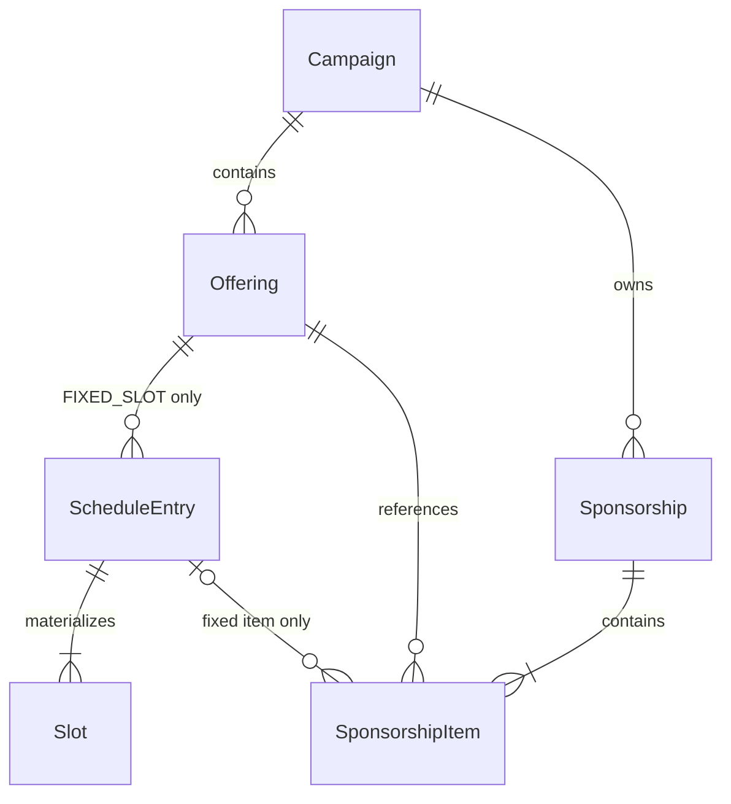

# Fasa 10.0 — Ramadan Sponsorship Domain Foundation

## Fasa 10.2b — COMPLETE / OWNER-APPROVED

[Ramadan verification, all-or-nothing slot admission and immutable receipt](RAMADAN-PAYMENT-VERIFICATION.md) adds exact-amount manager review, controlled proof rejection/resubmission, a non-financial capacity exception, protected native PDF receipt and verified-only safe public names/occupancy. Accepted deactivated offerings/schedules remain eligible. No pending reservation, amount override, partial financial/slot approval, refund, waitlist, gateway or 10.3 reporting/Excel is added. The historical 10.0/10.1/10.2a scope and test evidence below describe those approved checkpoints. Fasa 10 remains IN PROGRESS; 10.3 NOT STARTED. No hosted mutation/deployment. Owner-approved checkpoint: `phase-10.2b-ramadan-payment-verification`. 10.2c official Ramadan calendar change management is NEXT / NOT STARTED.

**Fasa 10.0 complete / owner-approved — Ramadan Sponsorship Domain Foundation.** Owner approval: 18 October 2026 (+08:00), with no functional changes requested. Checkpoint: `phase-10.0-ramadan-domain-foundation` (resolve tag for commit). Baseline `a96fd5b640e043d4e5c08639794689d8ca61a58a`, tag `phase-9.1-qurban-payment-verification`. Fasa 8 and Fasa 9 remain complete / owner-approved. This approved foundation creates only architecture, typed annual Campaign registration and private domain constraints. It does not implement 10.1–10.3 or claim production launch readiness.

Additive migration: `supabase/migrations/20261017153123_ramadan_domain_foundation.sql`. All thirteen historical migrations remain unchanged. No business rows, future annual configuration, flags or offerings are seeded.

## Fasa 10.1 COMPLETE / OWNER-APPROVED

[Management/public submission contract](RAMADAN-SPONSORSHIP-MANAGEMENT.md): complete / owner-approved, including final Malay UX and server/DB-derived public-name snapshot. Owner approval: 18 October 2026 (+08:00), with no further functional or visual changes. Checkpoint: `phase-10.1-ramadan-management-submission` (resolve tag for commit). Fasa 10 remains IN PROGRESS; 10.2a complete / owner-approved; 10.2b COMPLETE / owner-approved; 10.2c NEXT / NOT STARTED and 10.3 NOT STARTED. Owner locks deactivation as close-new-intake only; accepted sponsorships/quotes remain valid and retained, and future payment verification must not deny solely for later offering/schedule deactivation. Accepted offering labels are immutable snapshots; date/day/price/count remain activity-locked. The following foundation/no-runtime statements describe the approved **10.0 checkpoint**. 10.1 adds bounded management/public submission only; 10.2a is now the owner-approved private-proof checkpoint described below; 10.2b is the current uncommitted verification/receipt candidate; 10.3 remains not started.

## Owner decisions 1–14

1. Two controlled offering modes: `FIXED_SLOT` and `OPEN_AMOUNT`; no arbitrary form-builder JSON.
2. Offerings are campaign-scoped, admin-defined names. Iftar & Moreh, Sahur and Tabung Pengimarahan Ramadan are examples, never code enums/seeds.
3. Fixed sponsorship chooses explicit service date, offering and quantity; schedules may cover any subset of Ramadan days 1–30, with independently reviewed prices/counts.
4. A sponsorship is one payer/checkout with multiple items; items may span dates, offerings and a general open contribution. Future payment/receipt belongs to the aggregate, not each item.
5. Fixed item total is exact quantity × accepted unit price. Open contribution has no schedule, quantity, unit price or slot.
6. Public naming is an explicit `named`/`anonymous` choice. Anonymous requires NULL display name; future public projection renders **Hamba Allah**. The private payer identity remains retained; 10.1 derives a named display snapshot from payer_name and rejects independent caller-selected display names.
7. “Taja 1 Hari Penuh” is future UI convenience for a FIXED_SLOT quantity, never a third product type.
8. Sponsor never chooses slot coordinates; opaque slot IDs and schedule-scoped numbers are operational coordinates.
9. Submission and proof submission do not reserve/occupy slots. Only future verified payment may admit occupancy. Future UI must say: “Penghantaran borang belum menjamin slot tajaan. Slot hanya akan diberikan selepas bayaran disahkan oleh pihak masjid.”
10. Future admission is all-or-nothing across every fixed item in the checkout. Insufficient capacity assigns nothing; no partial verified checkout.
11. Future allocation picks earliest suitable free slot numbers within each schedule. No random choice, preferred slots or reshuffling.
12. Once items reference a schedule, price/count/date/day identity is locked. Referenced offering mode is locked. Before activity, draft capacity can regenerate the empty grid; no runtime management command exists yet.
13. Bank transfer only for the website. Historical cash/cheque/CDM fields do not authorize web workflows. Future 10.2 uses the reviewed private proof/Storage pattern, not Qurban business tables.
14. Ramadan remains a separate typed domain. Future receipt `RAM-<campaign_year>-000001` represents one verified aggregate and uses private payer name. Public schedule uses only reviewed verified public display data.

## Historical reference versus annual configuration

Owner-provided historical facts include Iftar/Moreh RM5,400 per full day / RM450 per slot, Sahur RM1,500 per day, a general Ramadan contribution and multiple slots per date. Those facts were supplied in this task; original historical artwork/forms were not re-opened here. They are evidence of operational variety, not future prices, 12/3-slot defaults, Ramadan 21–30 rules, a full 30-day schedule or a future year.

The exact Campaign tuple is `ramadan / 1 / ramadan.enabled`. Config v1 is an exact three-key object:

| Key | Contract |
| --- | --- |
| campaign_year | Integer 1900–9999, explicitly reviewed annual value |
| hijri_display_label | Plain trimmed 1–80 characters, no HTML/control characters |
| currency | Exact `MYR` |

Unknown keys, wrong types, missing values and config beyond 512 UTF-8 bytes fail closed. No payer, schedule, price, slot, payment or receipt data belongs in generic config/audit. Missing `campaigns.enabled` or `ramadan.enabled` remains OFF. No flag is created/enabled.

`src/lib/ramadan/config.ts` retains the concrete configuration type. The existing `CampaignAdminAdapter<C, F>` supports blank/incomplete annual form state separately from valid persisted config. `src/lib/ramadan/admin-adapter.tsx` supplies only the existing generic Campaign annual-config editor; it is **not** Ramadan offering/schedule/admin management UI. There is no raw JSON fallback. Catalog-aware regression expectations and local-reset health proof now require the exact two approved tuples. Qurban fixture inspection counts its own descriptor only; isolated older upgrade/catalog tests retain their historical expectations. No Qurban business function, migration or production runtime flow was changed. The registry now has exactly two reviewed adapters/descriptors: one unchanged Qurban and one Ramadan. Exact descriptor/adapter intersection remains mandatory.

## Typed private model

All identities are UUIDs, campaign ownership uses composite foreign keys where required, and references use RESTRICT. No global Person table/name matching is introduced.



There is deliberately no sponsorship-to-slot ownership/assignment relationship in 10.0.

| Table | Fields and exact foundation constraints |
| --- | --- |
| private.ramadan_offerings | id, campaign_id, name (trimmed/plain 1–100), generated normalized_name (lowercase, collapsed internal whitespace), mode, display_order (0–9999), active, created_at, updated_at, version. Unique campaign + normalized name, stable identity. |
| private.ramadan_schedule_entries | id, campaign_id, offering_id, ramadan_day_number (1–30), finite explicit service_date, unit_price_minor (1–1,000,000,000), slot_count (1–1000), active, timestamps/version. Same-campaign FIXED_SLOT only. Unique campaign + offering + service_date. No assumption every day exists or that each date has the same price/count. |
| private.ramadan_slots | id, campaign_id, schedule_entry_id, slot_number. Unique schedule + number; range 1..configured count. No sponsor/contact/occupation/assignment fields. |
| private.ramadan_sponsorships | id, campaign_id, DB-generated opaque public_reference (`RSP-` + two random UUID hex values), payer_name (1–160), phone (8–30 characters / 8–15 digits), nullable email (bounded 254), public_display_mode, nullable public_display_name (1–160 when named), quoted_total_minor, currency MYR, immutable accepted campaign_year/campaign_revision/hijri_display_label, status submitted/cancelled, timestamps/version. |
| private.ramadan_sponsorship_items | id, campaign_id, sponsorship_id, offering_id, mode, nullable schedule_entry_id/quantity/accepted_unit_price_minor/contribution_amount_minor, generated line_total_minor, server created_at. Exact fixed/open shape, same-campaign aggregate/offering/schedule, immutable accepted item. |

The sponsorship reference is generated by the DB, not caller-selected or derived from name/phone/year. It is not an authorization or public PII lookup capability. Matching names/phone never deduplicate payers. Owner 10.1 refinement supersedes the independent public-name choice: named submission snapshots validated payer_name as public_display_name; anonymous stores NULL. The public request cannot supply a separate name. Accepted payer/display identity is immutable, and public projection remains verified-only.

FIXED_SLOT items require schedule, positive quantity ≤1000 and ≤configured slot_count, accepted unit price; contribution is NULL. The guard derives price from the locked schedule; a supplied conflicting price is rejected. OPEN_AMOUNT items require only a positive contribution; schedule/quantity/unit are NULL. Both use generated exact line totals. Multiple lines for one schedule are permitted, but their combined quantity within one checkout cannot exceed that schedule's configured quantity. Pending checkouts across different sponsorships do **not** consume/reserve global capacity.

## Exact money and aggregate integrity

`private.ramadan_minor_units` is an **integer-only exact NUMERIC domain**, not floating point and not decimal currency units. `scale(value)=0` and range 1..1,000,000,000,000 reject fractional, negative, non-finite and oversized amounts. Using an unscaled NUMERIC domain avoids PostgreSQL silently rounding a fractional numeric input when casting directly to BIGINT. Schedule/unit limits are narrower (1,000,000,000 minor units). The one-minor-unit floor is technical positivity, not an invented minimum donation.

Deferred constraint triggers require 1–100 items and exact aggregate sum at transaction completion. A future trusted submission command must derive the aggregate from current locked schedules/contributions; client totals will not be authoritative. A wrong supplied aggregate or missing items cannot commit. Original total/items/accepted annual evidence are immutable. Foundation status is submitted/cancelled, with terminal cancellation; no runtime cancellation command exists, and later financial cancellation must fail closed when financial activity exists.

## Slot materialization and activity locking

The internal schedule AFTER trigger creates exactly Slot 1..N. Deferred integrity plus unique/range constraints proves the complete grid. Before activity, changing slot_count deletes/regenerates that schedule's empty slots with fresh UUIDs; changing price alone retains slot identities. Direct slot updates/deletes are denied; nested deletion is permitted only as part of an activity-free rebuild/schedule removal. Unused schedules/offerings may be removed internally; no activity-bearing hard-delete/runtime control exists.

Any sponsorship item locks schedule unit price/count permanently, including cancelled historical sponsorships. Owner-approved activity locking includes date/day identity: no historical sponsorship may silently move to another service date; a later rescheduling workflow needs separate review. Offering mode cannot change while schedules or items reference it, preserving OPEN_AMOUNT's no-schedule invariant; an entirely unused draft offering may change mode. Name/order/active flags remain mutable foundation fields with server timestamps/version; amendments and authorization commands belong to 10.1. Deactivating is not deletion or quote rewriting.

All record writes serialize using a transaction-scoped campaign/domain advisory lock and authoritative campaign validation. Future commands must acquire that domain lock **before DML**, lock campaign/parents in a consistent order and use expected versions; trigger enforcement alone is not a complete future command concurrency design. No public management/admission API is introduced here.

## Objects, ACL and PII

Six private functions, all fixed empty search_path:

- `ramadan_text_valid(text,integer,integer)` and `ramadan_config_v1_valid(jsonb)` — immutable pure validators.
- `ramadan_campaign_valid(uuid)` — same-campaign typed config check / campaign row share lock.
- `ramadan_record_guard()` — stable identities, ownership, shape, quote/price/activity guards and server timestamps/version.
- `ramadan_materialize_slots()` — activity-free internal grid generation.
- `ramadan_integrity_guard()` — read-only deferred checker. Only this helper is SECURITY DEFINER so deferred checks still run after a future trusted wrapper returns; trusted migration owner, no runtime EXECUTE, no mutation API.

Ten triggers: five BEFORE guards, schedule materialization AFTER trigger, four deferred schedule/slot/sponsorship/item integrity triggers. Twenty-one indexes in total: fourteen PK/unique backing indexes plus seven explicit indexes: `ramadan_offering_campaign_order`, `ramadan_schedule_offering`, `ramadan_slots_campaign_schedule`, `ramadan_sponsorship_campaign`, `ramadan_items_sponsorship`, `ramadan_items_offering`, partial `ramadan_items_schedule`; PK/unique backing indexes additionally enforce coordinates/ownership/names/references.

| Principal | Raw table CRUD | Private helper EXECUTE | Public sponsorship/payment/assignment/receipt commands |
| --- | --- | --- | --- |
| PUBLIC, anon, authenticated | Denied | Denied | None |
| service_role, supabase_auth_admin, authenticator | Denied | Denied | None |
| campaign_scheduler, qurban_proof_storage_worker | Denied | Denied | None |
| Migration owner / isolated local fixture | Trusted schema/test access | Internal only | No runtime command created |

All five tables have RLS enabled and zero permissive policies. Domain type usage is also revoked from runtime roles. Private schema remains unexposed; generated public Supabase types contain no Ramadan business rows. No runtime service-role client/credential, Storage change, public projection, unrestricted audit JSON or caller-controlled bypass is introduced. Generic Campaign Foundation authorization still controls annual draft config creation; it does not grant domain CRUD. A dedicated business-audit writer is deferred until the first real 10.1 mutation; no business mutation exists in 10.0.

## Future integration contracts — not implemented

10.1 must implement bounded authorized management and public safe context/submission, lifecycle/visibility/flags/DB-time gates, optimistic concurrency, immutable checkout quote, idempotency and minimized domain audit. Anonymous display must never leak private payer identity. Historical payer contact remains private, never generic Campaign DTO/config/audit/browser fixtures.

Future bank instruction reference: **Bank Islam — 1227 0010 0045 60 — MASJID TALHAH BIN UBAIDILLAH**. This is organisational bank-transfer direction only; no payment form/proof/verification/gateway or Storage implementation is added in 10.0.

10.2 must reuse the reviewed **pattern** of scoped participant capability/private proof Storage, Foundation authorization and bank-transfer evidence while using separate Ramadan business tables. It must not call Qurban registration/payment/receipt/allocation tables. Future Ramadan proof capability/Storage authorization must be independently scoped; 10.0 grants no Ramadan access to the existing Qurban Storage worker. Revalidate the immutable aggregate quote under the separately reviewed 10.2 financial policy and require enough free capacity for every fixed item in one transaction; assign all earliest suitable free slots or none. OPEN_AMOUNT consumes no slots. Proof submission alone reserves nothing. No holds/expiry/public slot choice/random allocation/reshuffling are approved. Refund/overflow/waitlist policy needs separate owner review.

Future `RAM-<campaign_year>-000001` receipt uses private payer name and immutable multi-item issuance snapshot. Public anonymity does not alter receipt payer identity. No numbering/counter/PDF is implemented here.

Future public projection may expose offering name, day/date, configured price/count and **verified** occupied/available counts plus explicitly permitted public display names / Hamba Allah. Pending/unverified identities do not appear as occupants. No phone/email/proof/payment reference/private UUID/admin note is public. No public schedule/list UI exists in 10.0.

## Local synthetic review — repository root

Use the official dedicated workspace and existing disposable `mtu-admin-local` stack. Never use a hosted DB. Run:

```powershell
node scripts/admin-foundation/local-cli.mjs start
node scripts/ramadan-domain/review-fixture.mjs
```

If the new migration has not been applied, a full local reset is appropriate only after confirming the disposable DB has no owner data requiring preservation:

```powershell
node scripts/admin-foundation/local-cli.mjs db reset --local --no-seed
node --test scripts/ramadan-domain/local.test.mjs
```

The fixture rejects production/Vercel/hosted environment markers and nonlocal or unproven Docker endpoints before DB access, then validates the exact project/loopback local stack and uses migration-owner SQL only. Synthetic admin/Auth/campaign/domain rows live inside **one transaction that always ROLLBACKs**. A failed SQL process closes its uncommitted transaction. There is no persisted setup session, HTTP endpoint, disable-trigger deletion, broad cleanup or automatic reset. Run again for repeat review; unrelated pre-existing records remain untouched. This is foundation evidence, not genuine OAuth/MFA/public submission or payment verification.

Synthetic year 2048 and label LOCAL REVIEW ONLY are never app defaults/seeds. Three arbitrary offerings: two fixed and one general open. Schedules: day 2 / 2048-04-03 / 17777 minor / 4 slots; day 9 / 2048-04-10 / 23901 minor / 6 slots; day 23 / 2048-04-24 / 31111 minor / 5 slots. One named aggregate has 2, 1, 2 fixed quantities plus 4567 open contribution: **126244 minor**, four items, fifteen unoccupied slots. No financial or slot-assignment records exist.

## Phase split and remaining gates

| Phase | Scope / status |
| --- | --- |
| 10.0 | Architecture + private domain foundation — complete / owner-approved |
| 10.1 | Admin offering/schedule management + public schedule + public sponsorship submission — complete / owner-approved |
| 10.2a | Private Ramadan proof intake — complete / owner-approved |
| 10.2b | Admin verification + atomic slot assignment + Ramadan receipt — implementation candidate awaiting owner review |
| 10.3 | Reporting + Excel + operational polish + final Ramadan checkpoint — NOT STARTED |

Actual annual values, offering/date/price/count decisions, public display copy, admission/retention/privacy operational policies and future cancellation/refund/overflow handling require their reviewed phase. No historical amount/slot/day/year is a production default.

## Verification evidence

**1,793 unique automated cases passed; zero final failures, reruns excluded.** This includes 95 Ramadan DB cases, 14 typed-adapter cases, five upgrade cases, nine local-fixture gate cases, eleven real PostgreSQL/API cases, responsive annual-editor coverage and all predecessor regressions. TypeScript, lint, final production Webpack, generated public-type parity, 291-chunk security scans, 69-document/447-link checks and git diff --check passed. Fresh fourteen-migration reset leaves exactly Qurban/Ramadan descriptors, zero flags/campaigns/business/Auth fixture rows; all thirteen historical migration byte hashes and eight known unmanifested backing files are unchanged. New suites: `scripts/ramadan-domain/database.test.mjs`, `adapter.test.ts`, `upgrade.test.mjs`, `fixture.test.mjs`, `local.test.mjs`. They cover exact descriptor/config/blank draft, 95 foundation DB cases, historical migration/function/ACL preservation, real PostgreSQL materialization/mixed checkout/rollback, RLS/private Data API denial and zero-business-data cleanup. Previous Qurban/Campaign/Foundation, production build/type parity/security/link/diff checks were rerun for the owner-approved checkpoint. The known eight unmanifested synthetic Qurban Storage backing files remain untouched/unadopted; Ramadan adds no Storage implementation or hosted operation. Local Qurban regression cleanup remains ownership-proven and excludes those eight files.

## Fasa 10.2a COMPLETE / owner-approved

Owner manually retested and approved sponsorship registration, successful proof intake and the local-only token-renewal fix. Verification was intentionally unavailable at that checkpoint. Checkpoint: `phase-10.2a-ramadan-payment-proof`; 10.2b COMPLETE / owner-approved; 10.2c NEXT / NOT STARTED and 10.3 NOT STARTED.

[Private Ramadan proof intake](RAMADAN-PAYMENT-PROOF.md) additively binds a separate hashed capability to new idempotent submissions, provides trusted Bank Islam instructions and private pending evidence. Existing accepted sponsorships remain eligible after new-intake closure while submitted, flags ON and campaign not archived, as explicitly owner-approved. At the approved 10.2a checkpoint no slot occupation, verification, receipt or reporting was added, and 10.2b/10.3 had not started; see the current owner-approved 10.2b checkpoint above. Named/anonymous accepted identity and deactivation/quote locks remain unchanged.
